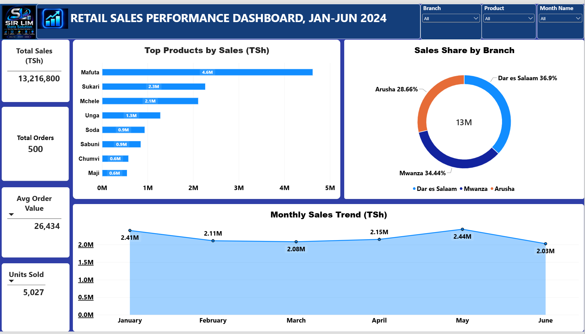

# Retail Sales Performance Dashboard (Jan-Jun 2024)

End-to-end sales analysis for a 3-branch retail business, built with Python (Pandas), Excel and Power BI.

> Note: this is a practice dataset created to simulate a real client project.

## Business Questions
1. What are the total sales?
2. Which products perform best?
3. Which branch sells the most?
4. How do sales change month to month?

## Tools
- Python (Pandas, Jupyter Notebook): data cleaning and analysis
- Excel: clean data handover
- Power BI: interactive dashboard (KPIs, charts, slicers)

## Process
1. *Inspect* the raw data (info, describe, nulls, duplicates)
2. *Clean* the data:
   - Removed 10 duplicate orders (510 to 500 rows)
   - Fixed 16 missing prices and 1 negative price using each product's standard price
   - Replaced 1 outlier quantity (900) with the median
   - Standardised product names and converted dates
3. *Create columns*: Total Sales, Month, Month Name
4. *Analyse* with Pandas and answer the business questions
5. *Visualise* in Power BI and validate every figure against Pandas

## Key Findings
- *Total sales:* TSh 13,216,800 from 500 orders (average order TSh 26,434)
- *Top product:* Mafuta, about 35% of sales. Mafuta, Sukari and Mchele together make up about 68%.
- *Top branch:* Dar es Salaam (36.9%), then Mwanza (34.4%) and Arusha (28.7%)
- *Best month:* May (TSh 2.44M). *Weakest:* June (TSh 2.03M)

## Files
| File | Description |
|---|---|
| PROJECT2.ipynb | Cleaning and analysis code |
| sales_raw.csv | Raw data (with intentional errors) |
| Sales1_clean.xlsx | Cleaned data |
| Sales1_Dashboard.pbix | Power BI dashboard |
| dashboard.png | Dashboard screenshot |

## What I Learned
- Cleaning decisions must be documented
- Dashboard figures should always be checked against the source analysis
- Each chart should answer one business question

*Author:* SIRLIM-SMS
